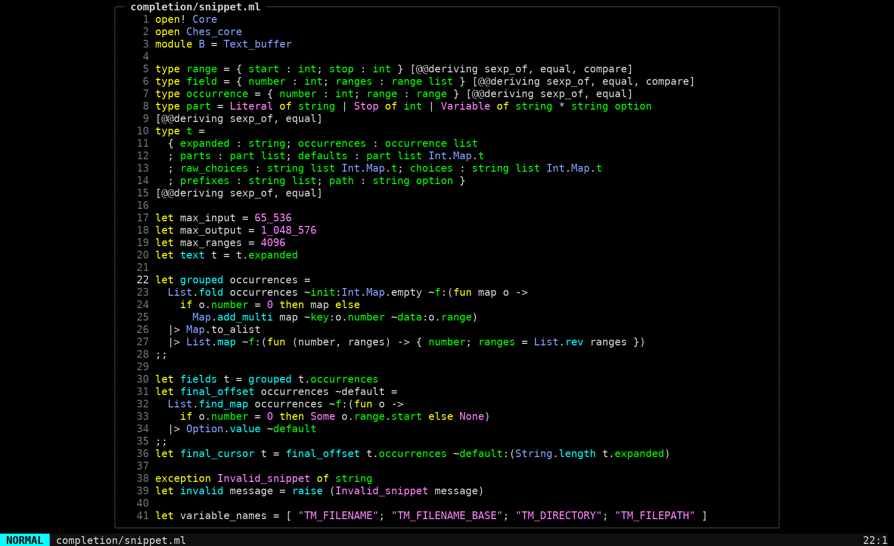
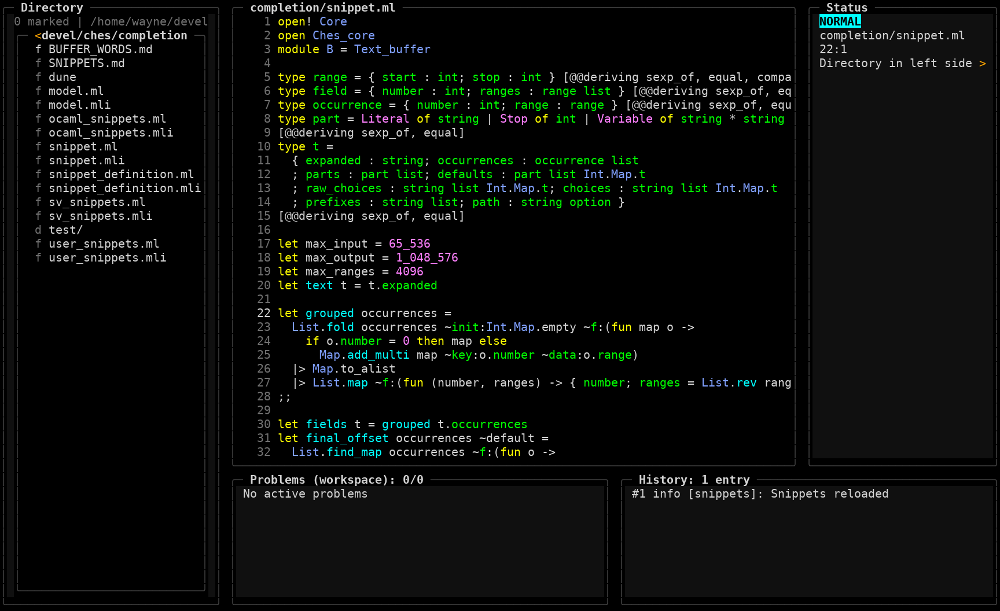
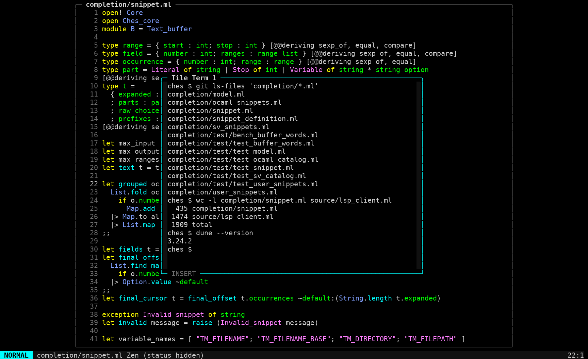
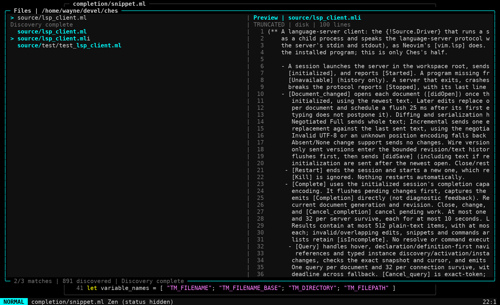
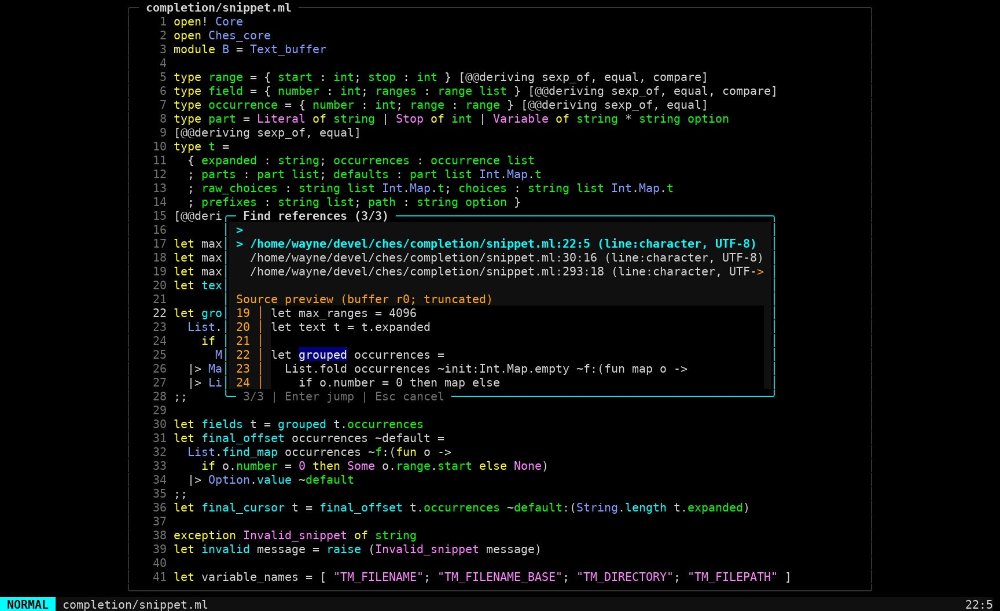

# Ches

**A modal terminal editor with a tile-based workspace.**

Ches brings Vim-style editing, floating shells, code completion, language-server
navigation, and Git into one keyboard-driven workspace. Written in OCaml, with a
[Bonsai_term](https://github.com/janestreet/bonsai_term) frontend.

[Getting started](#getting-started) · [Keybindings](docs/editor_reference.md#keys) ·
[Configuration](docs/configuration.md) · [Packaging](docs/releases.md) ·
[Documentation](docs/README.md)



*Ches editing Ches: `completion/snippet.ml`, in the default Vim Classic theme.*

## A workspace that stays out of your way

- **Modal editing.** Normal, Insert, and characterwise, linewise, and blockwise
  Visual modes, with counted motions, operators, search, indentation, and undo.
- **Tiles when you need them.** Start in Zen, open supporting views around your
  document, or switch to borderless Bare mode. Keep independent files in tabs.
- **Find your place.** Fuzzy file and current-document pickers, project content
  search, and editable directory listings for working across a project.
- **Git without leaving the editor.** A lazygit/Magit-inspired view for diffs,
  staging, commits, branches, history, and merge or rebase conflicts.
- **Language-aware editing.** Built-in Tree-sitter highlighting for OCaml, Verilog,
  SystemVerilog, and GAS assembly. Attached language servers supply completion,
  hover, definitions and references; OCaml also supports signature help and
  interface/source switching. Inspect servers with `Space l i`.
- **Reusable snippets.** Searchable templates, linked fields, choices and filename
  variables, with custom snippets defined in your OCaml configuration.
- **Make it yours.** Executable `config.ml`, live theme previews, semantic completion
  colors, adjustable layouts, and optional key hints. Runtime changes remain
  session-local unless you put them in your configuration.

## From Zen to a workspace

**`Space v z`** switches between focused editing and the tile workspace. Keep a
directory browser beside your source, with status, problems and notification
history in supporting tiles.



## Tile Terms

An interactive shell, one toggle away. **`Space /`** opens or hides a Tile Term;
**`3 Space /`** selects terminal 3. Each numbered session keeps its shell, jobs,
screen, and preferred size while hidden.



Toggle directly from Normal or Insert mode. Use rapid **`jk`** to enter terminal
Normal mode, then navigate, select, and yank text into the editor. **`i`** returns
to the shell; **`+` / `-`** resize the float.

See the [Tile Terms guide](docs/editor_reference.md#floating-terminal) for modes,
numbered sessions, and Insert-mode shortcut timing.

## Find code without losing your place

Project files and symbol references have source previews. Inspect the result first,
jump when you're ready, and use **Ctrl-o** to return.

<details>
<summary><strong>Project navigation</strong> — fuzzy file search with source preview</summary>



</details>

<details>
<summary><strong>Find references</strong> — real ocamllsp results with a highlighted source preview</summary>



</details>

These captures use real repository files and live application output. The
[capture recipe](docs/images/README.md) describes the reproducible terminal-frame
rasterization and its limits.

## Getting started

### Linux download packages

Ches can be packaged as an extract-and-run **`.tar.gz`** containing its executable,
notices, source snapshot, manifest and checksums. Basic editing does **not** require
an OCaml/opam installation: highlighting assets and terminal emulation are embedded.

The currently tested build targets **Linux x86-64 with glibc 2.38 or newer**
(built on Ubuntu 24.04). It is not a universal static binary. Git, ripgrep, language
servers, and `ocamlc` for evaluating `config.ml` are optional external tools for
their respective features.

From the development checkout, create a download package with:

```sh
python3 scripts/package_release.py --version snapshot --strip -j 6
```

Artifacts are written to `dist/`. See the [release/installation guide](docs/releases.md)
for extraction, verification, platform requirements, and the outstanding
source/license work before a public release. No hosted release is published by
this command.

### Build from source

With the [development toolchain](docs/development.md#toolchain) available:

```sh
dune build -j 12 bin/ches.exe
_build/default/bin/ches.exe .
```

Open a directory to browse a project, or pass a file path to edit it. If you have
`ches` on your `PATH`:

```sh
ches completion/snippet.ml   # Vim Classic theme, Zen layout
ches --workspace .           # Full tile workspace
ches --bare core/editor.ml   # Borderless editing (also --superzen)
ches --theme glacier .       # Choose a different theme
ches --list-themes           # Browse available palettes
```

### A few keys to start

`Space` below means the spacebar. Unless noted, editor commands use Normal mode.

| Keys | Action |
| --- | --- |
| `h` / `j` / `k` / `l` | Move |
| `i` / `Escape` | Enter Insert / return to Normal |
| `u` / `Ctrl-r` | Undo / redo |
| `Space w` / `Space q` | Save / quit |
| `Space c c` | Open the command palette |
| `Space f f` / `Space f g` / `Space f l` | Find files / search contents / find lines |
| `Space o` | Show the file's parent in the main area / return to file |
| `Space b n` / `Space b p` | Next / previous file tab |
| `Space g g` | Open the Git view |
| `Space l i` | Inspect attached language servers and their status |
| `K` / `gd` / `gD` / `gr` | Hover / declaration / definition / references |
| `Ctrl-o` / `Ctrl-i` | Jump back / forward |
| `Ctrl-n` (Insert) | Request completion manually |
| `Space /` / `N Space /` | Toggle Tile Term / select numbered session; also works in Insert |
| `Space v z` / `Space v B` | Toggle Zen / Bare |
| `Space v T` | Choose a theme |

The [editor reference](docs/editor_reference.md) covers the full keymap, directory
operations, and terminal controls. `ches --help` lists command-line options.

## Documentation

- [Editor reference](docs/editor_reference.md) — keys, modes, workspace, Git, and Tile Terms.
- [Directory workspace](docs/directory_workspace.md) — browsing and filesystem operations.
- [Pickers](docs/pickers.md) — file navigation and project search.
- [Development](docs/development.md) — toolchain, builds, and tests.
- [Configuration](docs/configuration.md) — OCaml settings, snippets, and completion colors.
- [Release packaging](docs/releases.md) — downloadable archives, installation, and runtime requirements.
- [Architecture](docs/architecture.md) — source layout and module boundaries.
- [Project status](docs/project_status.md) — support, limitations, and validation notes.

For design notes, backlogs, and implementation history, see the
[documentation index](docs/README.md).
